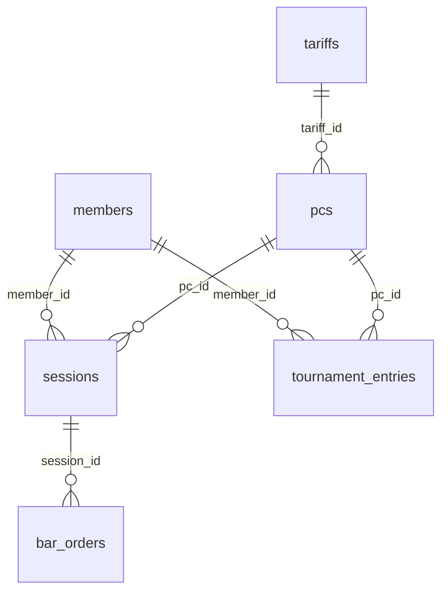

# Практическая работа №8. Перенос базы из SQLite в PostgreSQL и работа в DBeaver

## Цель работы
1. Подключиться к серверу **PostgreSQL** через **DBeaver** и освоить интерфейс программы (редактор SQL, конструктор таблиц, вкладку «Данные», импорт CSV и ER-диаграмму).
2. Перевести схему базы данных из **SQLite** в **PostgreSQL**: заменить нестрогие типы данных на строгие, настроить ограничения (`CHECK`, `UNIQUE`, `FOREIGN KEY`).
3. Разобрать основные отличия диалекта PostgreSQL от SQLite на простых однотабличных запросах.

---

## Схема базы данных («Компьютерный клуб»)

Во всех вариантах используется компактная схема (по 4–5 колонок в таблице):
* **Easy (5 таблиц):** `tariffs` (тарифы), `members` (игроки), `pcs` (компьютеры), `sessions` (сессии), `bar_orders` (заказы в баре).
* **Medium и Hard (6 таблиц):** добавляется таблица `tournament_entries` (заявки на турниры), связывающая `members` и `pcs`.



В папке каждого уровня лежит файл **`sqlite_schema_*.sql`** — это исходная схема для SQLite, которую нужно перевести на синтаксис PostgreSQL.

---

## Справочник отличий: SQLite $\to$ PostgreSQL

### 1. Типы данных (при создании таблиц `CREATE TABLE`)

В SQLite типы данных нестрогие (в поле `VARCHAR(10)` или `INTEGER` можно записать любой текст). В PostgreSQL тип каждого столбца строго проверяется сервером:

| Назначение поля | Как было в SQLite | Как писать в PostgreSQL | Особенность в PostgreSQL |
| :--- | :--- | :--- | :--- |
| Автоинкремент ID | `INTEGER PRIMARY KEY AUTOINCREMENT` | `SERIAL PRIMARY KEY` | Создает счетчик (`SEQUENCE`), автоматически выдающий `1, 2, 3...`. |
| Малые целые числа (часы, ОЗУ) | `INTEGER` | `SMALLINT` | Целое число (2 байта, от -32768 до 32767). |
| Обычные целые числа (внешние ключи) | `INTEGER` | `INTEGER` | Целое число (4 байта). |
| Деньги и цены | `REAL` | `NUMERIC(8, 2)` или `NUMERIC(10, 2)` | Точное десятичное число без потери копеек (`total_digits, decimals`). |
| Строки ограниченной длины | `TEXT` | `VARCHAR(n)` (например, `VARCHAR(20)`) | Строго проверяет длину: строка из 21 символа вызовет ошибку. |
| Логический тип (Да/Нет) | `INTEGER DEFAULT 0` (`0`/`1`) | `BOOLEAN DEFAULT FALSE` | Принимает `TRUE` / `FALSE`. В DBeaver отображается чекбоксом. |
| Дата | `TEXT` (`'2026-02-15'`) | `DATE` (`DEFAULT CURRENT_DATE`) | Календарный тип. Позволяет вычитать даты (`CURRENT_DATE - reg_date`). |

---

### 2. Ограничения (`Constraints`) и счетчики

* **Внешние ключи (`REFERENCES`):** в PostgreSQL работают всегда по умолчанию (команда `PRAGMA foreign_keys = ON` не нужна).
* **Именованные ограничения (`CONSTRAINT`):** правилам `CHECK` и `UNIQUE` можно дать имя, чтобы видеть его в тексте ошибки:
  ```sql
  balance NUMERIC(10, 2) NOT NULL DEFAULT 0.00 CONSTRAINT chk_member_balance CHECK (balance >= 0)
  ```
* **Поведение внешнего ключа при удалении (`ON DELETE`):**
  * `ON DELETE RESTRICT` — запрещает удалять запись, если на неё есть ссылки в других таблицах.
  * `ON DELETE SET NULL` — при удалении родительской записи ссылка в дочерней таблице заменяется на `NULL`.
  * `ON DELETE CASCADE` — при удалении родительской записи все связанные дочерние строки удаляются автоматически.
* **Удаление связанных таблиц:** используйте `DROP TABLE IF EXISTS имя_таблицы CASCADE;`.
* **Синхронизация счетчика `SERIAL` после импорта CSV:**
  При загрузке готовых `id` из CSV счетчик `SERIAL` остается на `1`. Чтобы следующая вставка без `id` не вызвала ошибку дубликата ключа, выполните:
  ```sql
  SELECT setval(pg_get_serial_sequence('members', 'member_id'), COALESCE(MAX(member_id), 1)) FROM members;
  ```

---

### 3. Синтаксис SQL-запросов

| Задача | В SQLite | В PostgreSQL | Пояснение |
| :--- | :--- | :--- | :--- |
| Строки в условиях | `'VIP'` или `"VIP"` | Только **`'VIP'`** | Двойные кавычки `"VIP"` в PostgreSQL означают имя столбца, а не строку. |
| Поиск без учета регистра | `LIKE '%cola%'` | **`ILIKE '%cola%'`** | `LIKE` в PostgreSQL чувствителен к регистру. Для поиска без учета регистра нужен `ILIKE`. |
| Фильтр по булеву полю | `WHERE is_active = 1` | **`WHERE is_active = TRUE`** | Для типа `BOOLEAN` используются `TRUE` и `FALSE`. |
| Замена `NULL` | `IFNULL(prize, 0)` | **`COALESCE(prize, 0)`** | Функции `IFNULL` в PostgreSQL нет, используется стандартная `COALESCE`. |
| Возврат вставленной строки | Нет | **`INSERT INTO ... RETURNING *;`** | Сразу выводит добавленную или измененную строку в результат запроса. |

---

## Краткая инструкция по работе в DBeaver

1. **Подключение к серверу:**
   * Нажмите **Новое соединение** $\to$ **PostgreSQL** $\to$ переключите на **URL**.
   * Вставьте строку (заменив `XX` на номер варианта `01`..`20`):
     `jdbc:postgresql://81.30.105.12:5432/club_varXX`
   * Логин: `student_XX`, пароль: `StudyPass2026_XX` $\to$ **Тест соединения** $\to$ **Готово**.
   * В левой панели раскройте: `club_varXX` $\to$ `Базы данных` $\to$ `club_varXX` $\to$ `Схемы` $\to$ **`public`** $\to$ **`Таблицы`**.
2. **Горячие клавиши редактора SQL (`F3`):**
   * `Ctrl + Enter` — выполнить один запрос под курсором.
   * `Alt + X` — выполнить весь скрипт целиком.
   * `F5` — обновить список таблиц в левой панели.
3. **Визуальный конструктор таблиц:**
   * Правый клик на папке `Таблицы` $\to$ **Создать Новую Таблицу** (или двойной клик по таблице $\to$ вкладка **Свойства**).
   * После добавления колонок или ограничений нажмите `Ctrl + S` — откроется окно **Persist Changes** с готовым SQL-кодом изменений.
4. **Импорт данных из CSV:**
   * **Способ 1 (через интерфейс DBeaver):** правый клик по таблице $\to$ **Импорт данных** $\to$ **Из файла CSV** $\to$ выберите файл $\to$ **Приступить**.
   * **Способ 2 (через Python):**
     ```python
     import pandas as pd
     from sqlalchemy import create_engine

     engine = create_engine("postgresql+psycopg2://student_01:StudyPass2026_var01@<IP_СЕРВЕРА>:443/club_var01")
     for tbl in ["tariffs", "members", "pcs", "sessions", "bar_orders"]:
         pd.read_csv(f"easy/variant_01/{tbl}.csv").to_sql(tbl, engine, if_exists="append", index=False)
     ```
     *(Важно: используйте только `if_exists="append"`, чтобы не затереть созданные в DBeaver типы и ограничения).*
5. **ER-диаграмма:**
   * Дважды кликните на схему `public` и откройте вкладку **ER-диаграмма**, чтобы увидеть схему таблиц и связей.
